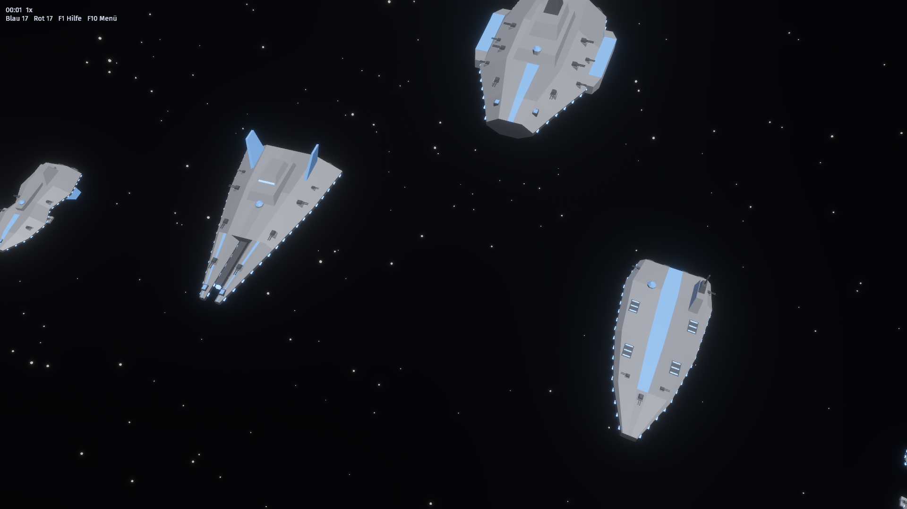
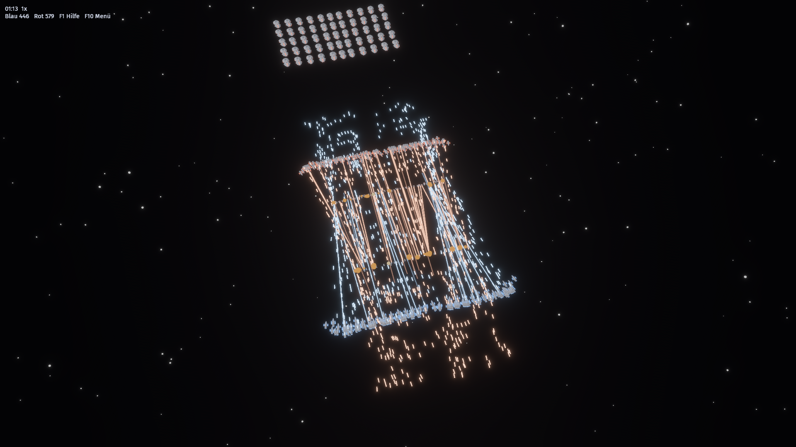
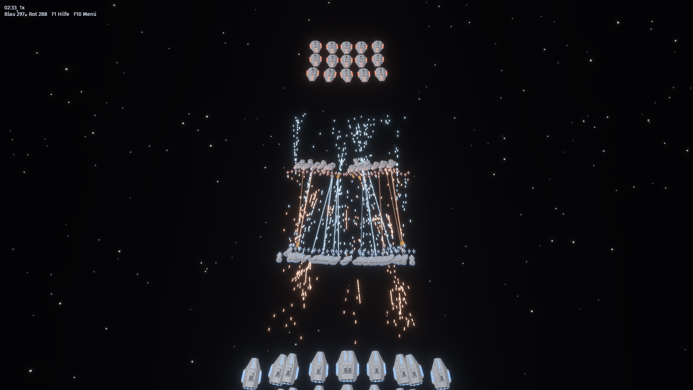
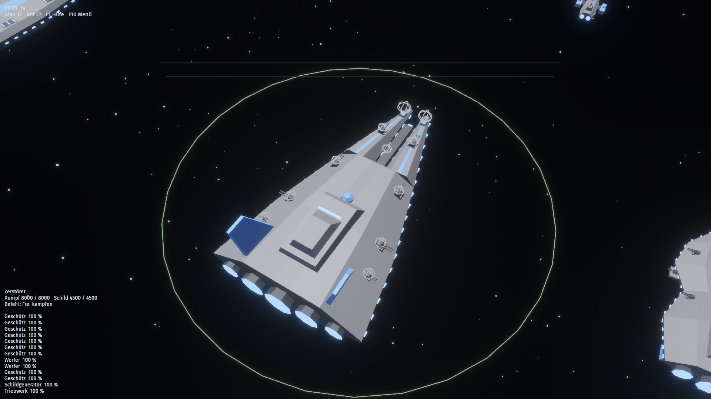
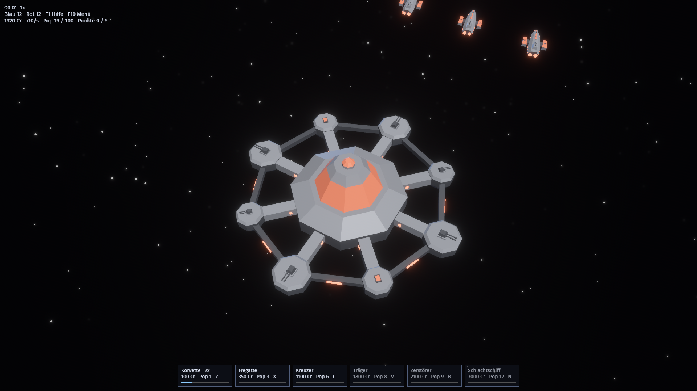
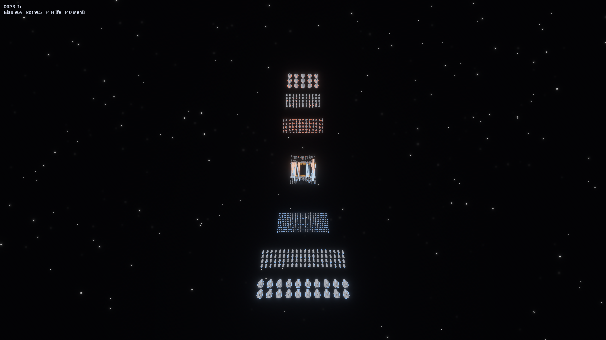
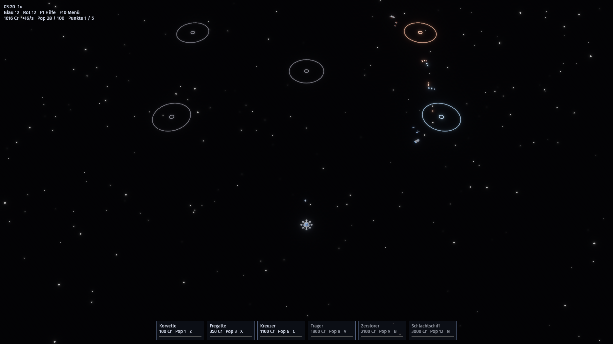

# Armada

A love letter to Star Wars: Empire at War's space battles. Own game, own code, no original
assets. Space-only RTS with fleets, hardpoints, firing arcs and deterministic lockstep sim,
written in Rust and Bevy. Early and changing fast.



| | |
|---|---|
|  |  |
|  |  |
|  |  |

## Layout

```
crates/
  sim/       deterministic simulation, depends on serde only
  ai/        skirmish AI, talks to the sim through commands only
  data/      RON content -> compiled defs, scenarios, replays
  headless/  CLI: run battles, record and verify replays, benchmark
  viewer/    Bevy, read-only view on the sim
content/
  base/      ship definitions
  scenarios/ battle setups
```

## Commands

```
cargo run --release -p armada-viewer                                   # start menu
cargo run --release -p armada-viewer -- content/scenarios/fleet_clash.ron  # 1000 vs 1000
cargo run --release -p armada-headless -- run content/scenarios/skirmish.ron --ai hard,easy --record target/sk.replay.ron
cargo run --release -p armada-headless -- verify target/sk.replay.ron
cargo run --release -p armada-viewer -- --replay target/sk.replay.ron
cargo test --workspace
```

Screenshots come from the viewer's photo mode, same flags give the same picture:

```
cargo run --release -p armada-viewer -- --shot out.png --tick 1100 --dist 650 --yaw 165
cargo run --release -p armada-viewer -- --shot menu.png --tick 0           # start menu
```

## Sim rules

These are what keeps lockstep multiplayer and replays working. Break one and you get desyncs
that only show up after 20 minutes on someone else's machine.

1. No floats in `armada-sim`. `clippy::float_arithmetic` is denied at workspace level. All math
   goes through `Fx` (48.16 fixed point). Floats are allowed in `data` (load time) and `viewer`.
2. No `HashMap`/`HashSet` iteration, no threads, no clock, no global state inside the tick.
3. One RNG per world, advanced in fixed order.
4. All external input is a `Command` in the `CommandLog`. Player, AI, scripts and network all
   go through it.
5. Data is struct-of-arrays in `World`. Ids are indices, dead ships stay as tombstones.
6. `state_hash` covers everything that influences future ticks. New state means a new hash input.

## Tick order

commands -> spatial grid -> centroids -> retarget (staggered, every 8 ticks) -> movement
(velocity pass, then integrate) -> weapons -> projectiles -> shield regen -> deaths ->
capture points -> income -> production -> outcome.

## Skirmish

Each side has a station that builds ships and is the win condition. Credits come from a base
income plus every owned capture point. A point flips after a lone team holds it for a while;
an enemy point first drains to neutral. Ships cost credits up front and take population.

The AI lives in its own crate and only sends commands, like a player. Headless `run` lets it
play both sides, and since its commands go into the log, `verify` replays without it.

Three levels, none of them cheat. Harder means faster reactions, a fuller build queue, earlier
attacks and using the whole population cap. Headless, hard beats easy and normal from either side.

## Ships and models

Seven types in `content/base/ships.ron`: corvette, frigate, cruiser, carrier, destroyer,
dreadnought and the station. The destroyer is a wedge with a split bow around a spinal lance,
nearly all of its guns point forward. The carrier's hangars send strike craft, for now as slow
homing salvos that mostly ignore shields.

Models are built in code (`viewer/src/models.rs`): a hull is a few cross sections lofted into a
skin, plus boxes and towers. Turrets, launchers, hangar pads and the shield dome are placed from
the hardpoint offsets of the ship definition, so moving a hardpoint in the RON moves it on the
model.

## Orders

- `Move`: line formation towards the point, small ships in front, capped at the slowest ship.
  Ignores enemies until it arrives, then holds.
- `AttackMove`: same formation, but fights anything it meets on the way.
- `Attack`: one target. Falls back to hold when it dies.
- `Stop` (hold): stays put, turns its best arc to whatever is in range.
- `Engage`: free AI, closes on the nearest enemy group.

In the viewer you play team 0. F1 shows all controls.

## Movement and arcs

Ships have a heading and a turn rate and only thrust forward: a ship facing the wrong way slows
down and turns first. In range of its target a ship stops at its engage range (longest weapon
range times 0.85 unless the ship file sets `engage_range`) and turns to its preferred bearing,
the one where the most damage per second bears. For broadside designs that is the beam.

Every weapon has a facing and an arc. It fires at the ship's target if that is in arc and range,
otherwise at its own target of opportunity. Trig at load time uses a polynomial instead of libm,
because libm results can differ between platforms.

## Weapons

`Beam` hits instantly on fire. `Projectile` (missiles, torpedoes) flies and homes on its target,
dies after its TTL, and can carry `shield_bypass`: that share of damage skips the shield.

## Damage model

Shield absorbs first (minus bypass). The rest hits a random intact hardpoint at full strength and the hull at
half. With no hardpoints left the hull takes everything. Destroyed shield generator stops regen,
destroyed engine halves speed.
